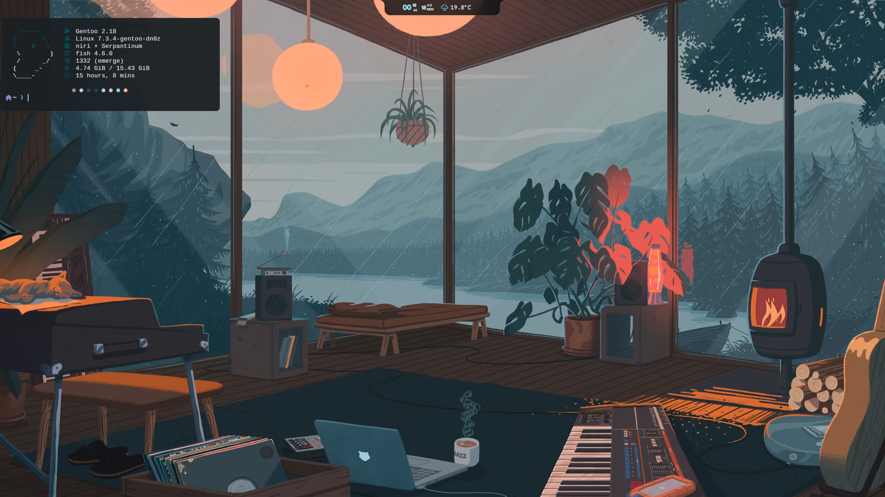

# dotfiles

Mi escritorio en Gentoo Linux: [niri](https://github.com/YaLTeR/niri) con
[Serpantinum](https://github.com/ilyamiro/serpantinum) (barra, lanzador, fondos y colores con matugen).



## Qué hay

| Qué | Dónde |
|---|---|
| niri (partido en varios ficheros con `include`) | `.config/niri/` |
| Serpantinum y plantillas de matugen | `.config/serpantinum/` |
| Terminal: kitty | `.config/kitty/` |
| Shell: fish (plugins: tide, fzf.fish, autopair, done) | `.config/fish/` |
| fastfetch (logo `gentoo_small`) | `.config/fastfetch/` |
| Neovim (basado en el de craftzdog, sin mason ni copilot) | `.config/nvim/` |
| GTK y Qt (adw-gtk3-dark, qt6ct) | `.config/gtk-3.0/`, `.config/gtk-4.0/`, `.config/qt6ct/` |
| Dolphin, btop, cava, yazi, bat, zathura, lazygit, fzf | `.config/…` |
| Scripts | `.local/bin/` |

Scripts:
- `niri-apilar-vertical`: en el monitor vertical, las ventanas nuevas se apilan debajo en vez de abrirse al lado.
- `sddm-matugen`: pasa el fondo y los colores de matugen a SDDM.
- `noche-inactivo`: de 2:00 a 8:00 apaga la pantalla y suspende antes (lo llama Serpantinum).

## Instalación

### 1. Paquetes

En Gentoo hace falta el overlay **guru** para niri, quickshell, matugen, cliphist, yazi y lazygit:

```sh
sudo eselect repository enable guru
sudo emaint sync -r guru
```

```sh
sudo emerge -av gui-wm/niri gui-apps/quickshell x11-misc/matugen \
  x11-terms/kitty app-shells/fish app-misc/fastfetch app-editors/neovim \
  app-misc/cliphist gui-apps/wl-clipboard media-sound/playerctl \
  sys-fs/inotify-tools app-misc/jq media-video/ffmpeg \
  sys-apps/eza app-shells/zoxide sys-apps/bat sys-fs/gdu app-shells/fzf sys-apps/fd \
  kde-apps/dolphin gui-apps/qt6ct x11-themes/adw-gtk3 \
  sys-process/btop media-sound/cava app-misc/yazi app-text/zathura dev-vcs/lazygit
```

En otras distros los nombres cambian, pero los programas son los mismos.

Además:
- **Serpantinum**: se instala siguiendo [su README](https://github.com/ilyamiro/serpantinum).
- **Fuentes**: una [Nerd Font](https://www.nerdfonts.com/) (uso 0xProto Nerd Font) y JetBrains Mono para kitty.

### 2. Copiar los dotfiles

Haz antes una copia de lo que ya tengas, porque se sobrescribe:

```sh
cp -r ~/.config ~/.config.antes
git clone https://github.com/dn0z1986/dotfiles.git
cd dotfiles
cp -r .config/. ~/.config/
mkdir -p ~/.local/bin && cp .local/bin/* ~/.local/bin/ && chmod +x ~/.local/bin/*
```

### 3. Primer arranque

- **fish**: instala los plugins con [fisher](https://github.com/jorgebucaran/fisher):
  ```fish
  curl -sL https://raw.githubusercontent.com/jorgebucaran/fisher/main/functions/fisher.fish | source && fisher update
  ```
- **Neovim**: al abrirlo la primera vez descarga los plugins solo (`vim.pack`).
- **niri**: cierra sesión y entra en niri desde tu gestor de inicio (SDDM, greetd…).

### 4. Ajústalo a tu equipo

- **Pantallas** en `~/.config/niri/config/output.kdl`: cambia `DP-3` y `HDMI-A-1` por las tuyas (las ves con `niri msg outputs`). El segundo monitor está en vertical (`transform "90"`).
- **Cursor** en `~/.config/niri/config/cursor.kdl`: pon un tema que tengas instalado, por ejemplo `"Adwaita"`.
- **Iconos** en `~/.config/qt6ct/qt6ct.conf`: `Clay-dn0z` es un tema mío; cámbialo por el tuyo.
- **Ubicación para el tiempo** en `~/.config/serpantinum/settings.json` (viene vacía), o desde los ajustes de Serpantinum (`Super+H`).
- **Rutas con `~`**: algunas apps (qt6ct, por ejemplo) necesitan la ruta completa; si algo no carga, cambia `~` por `/home/tu-usuario`.
- **Teclado**: está en `us` con variante `altgr-intl` (`~/.config/niri/config/input.kdl`).

## Instalar solo una parte

Cada carpeta funciona por separado. Por ejemplo, solo fastfetch:

```sh
mkdir -p ~/.config/fastfetch
curl -o ~/.config/fastfetch/config.jsonc \
  https://raw.githubusercontent.com/dn0z1986/dotfiles/main/.config/fastfetch/config.jsonc
```

> El módulo `wm` muestra "+ Serpantinum" fijo; cámbialo o quítalo en `config.jsonc` si no lo usas.

O solo niri, copiando la carpeta desde el repositorio clonado:

```sh
cp -r dotfiles/.config/niri ~/.config/
```

## Atajos principales

| Atajo | Acción |
|---|---|
| `Super+Enter` | kitty |
| `Super+D` | lanzador |
| `Super+E` | Dolphin |
| `Super+Q` | cerrar ventana |
| `Super+Tab` / `Super+Retroceso` | overview |
| `Super+W` | cambiar fondo |
| `Super+C` | historial del portapapeles |
| `Super+H` | ajustes de Serpantinum |
| `Super+1…0` | escritorios |
| `Super+Flechas` | moverse entre ventanas |
| `Super+Ctrl+Flechas` | mover ventanas |
| `Super+Shift+Flechas` | cambiar tamaño |
| `Impr Pant` | captura de pantalla |
